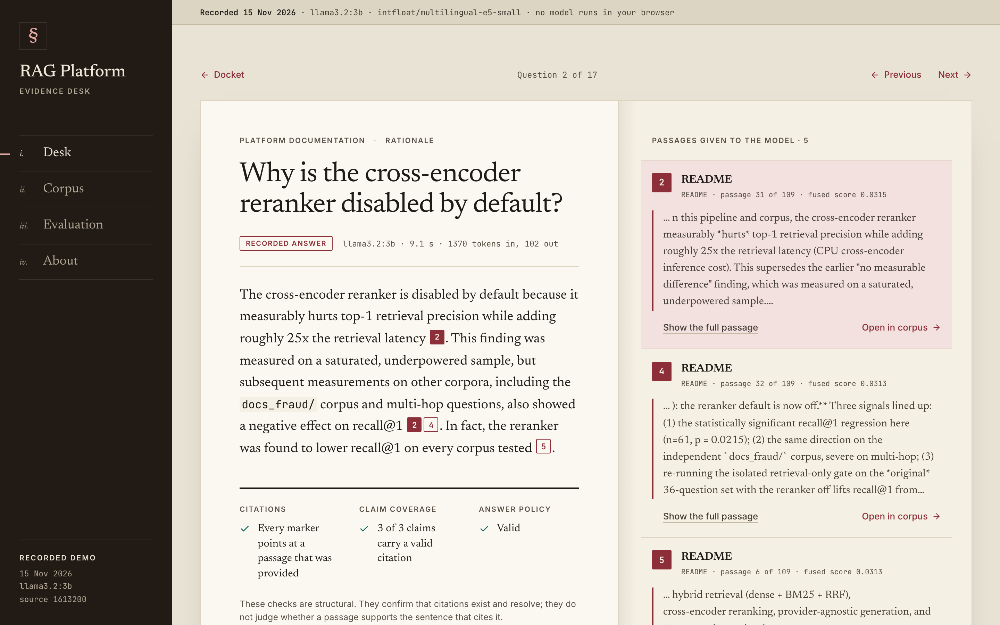
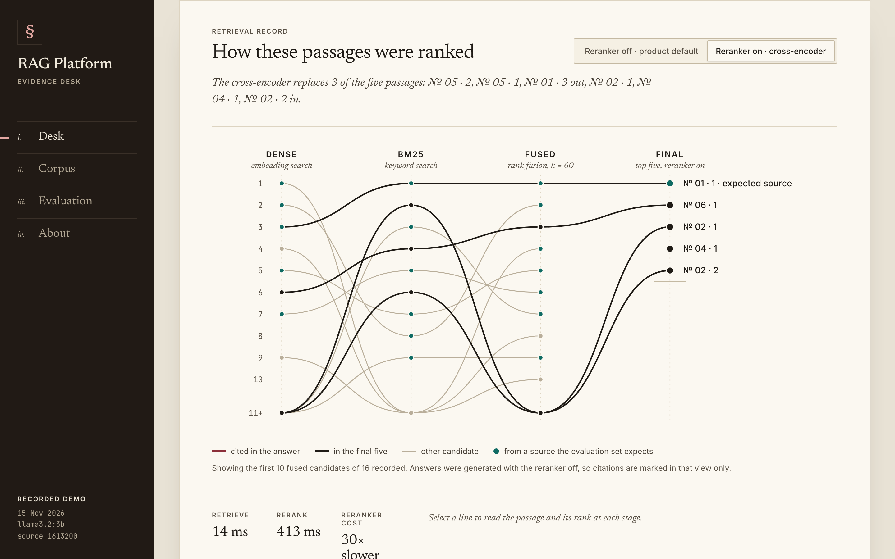
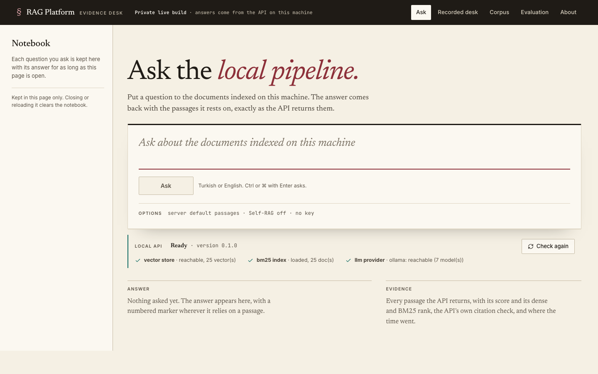

# RAG Platform · Evidence desk

**[Open the demo](https://erturkeryavuz.github.io/rag-evidence-desk-demo/)**

A recorded walkthrough of a retrieval-augmented generation service, built so that every answer can be read beside the passages it cites and the ranking that selected them.

This is a recording. No model runs in your browser, there is no question box, and the page makes no network connections.

## What the platform is

RAG Platform answers questions from a set of documents. It splits documents into passages, indexes them for dense and BM25 search, merges both rankings with reciprocal rank fusion, can rerank with a cross-encoder, writes an answer with numbered citations, and runs deterministic checks on those citations.

## What the demo shows

One recorded session of the real pipeline on a laptop, with local models only (`llama3.2:3b` for answers, `multilingual-e5-small` for embeddings):

- **Docket.** 17 recorded questions over two corpora: the platform's own documentation in English, and a Turkish fraud-awareness corpus used to test multilingual retrieval.
- **Folio.** The answer beside the passages given to the model, with a link from each citation to its passage.
- **Rank flow.** Each candidate passage's position in dense search, in BM25, after fusion, and in the final five, with the reranker off or on.
- **Evaluation.** A 21-question retrieval evaluation computed during the recording.
- **Corpus.** A map of passage embeddings and a passage reader.

## What the measurements showed

On these two corpora the cross-encoder reranker lowered recall and took far more time, most visibly on multi-hop questions, so the platform ships with it off. The demo shows the numbers. The corpora are small (109 and 25 passages), so this is a finding about this setup, not a general claim about rerankers.

The small local model sometimes answers wrongly while its citations remain structurally valid. Two such answers carry a reviewer’s note, labelled as not model output. Citation checks are structural; the platform does not claim an automatic groundedness score.

## Private Product Preview

The demo above is a replay of one recorded session. The platform itself runs privately on my own machine; its API, models and indexes are not publicly accessible, and nothing on this site connects to them.

On that machine, a private build of the Evidence desk is a research workspace connected to the real local API. These screenshots were taken there, with real questions answered by the same local models over the Turkish fraud-awareness corpus.

**Asking.** The question, the options the API actually applies, and the API's own health report.

**An answer and its evidence.** The answer with numbered citations, each passage the API returned with its score and its dense and BM25 rank, the API's citation check, stage timings, and the session notebook on the left. Fields the HTTP API does not return, such as claim coverage, are marked as not returned rather than drawn.

**On a phone.**

## Limits

- The recording was captured inside the pipeline, so it shows more than the HTTP API returns (ranks per stage, claim coverage).
- The fraud-awareness documents summarise public guidance from Turkish official bodies. They are a retrieval test set, not legal or financial advice.

## About this repository

It holds only the built, static demo, its screenshots and a 33-second walkthrough video (`media/rag-walkthrough.mp4`). The platform's source code is private.

Third-party licences: [THIRD-PARTY-NOTICES.md](THIRD-PARTY-NOTICES.md).

© 2026 Ertürk Eryavuz
