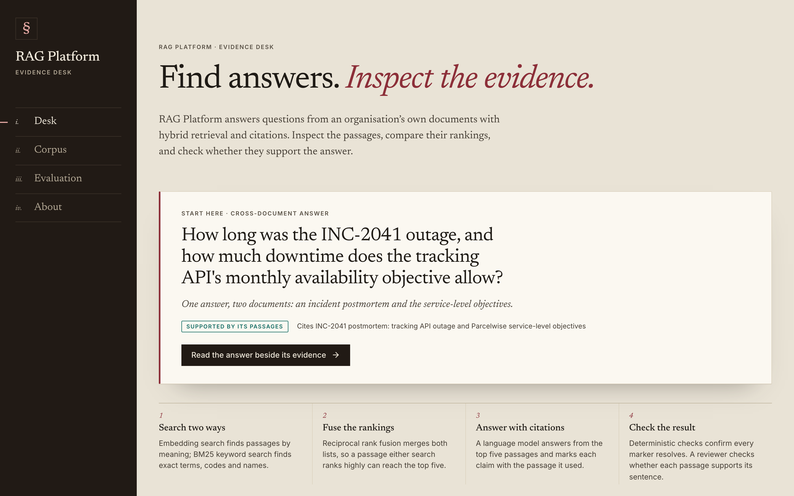
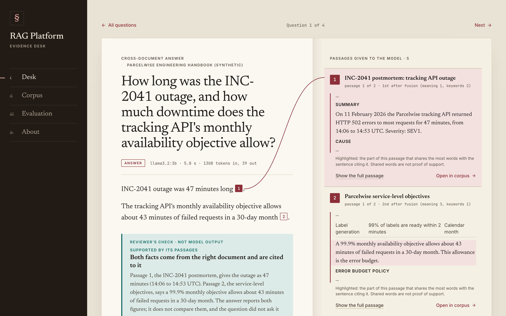
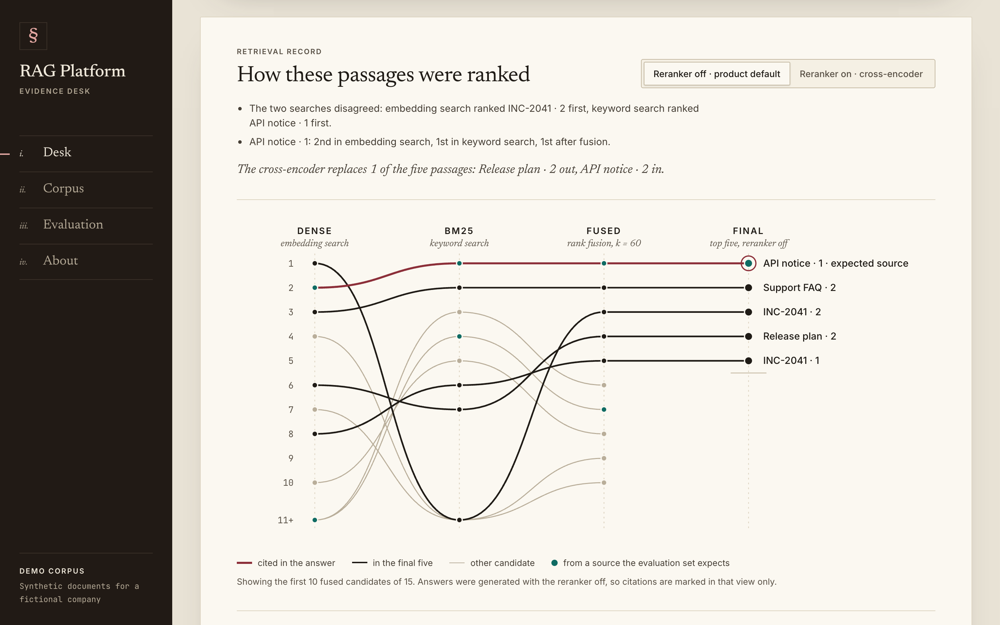
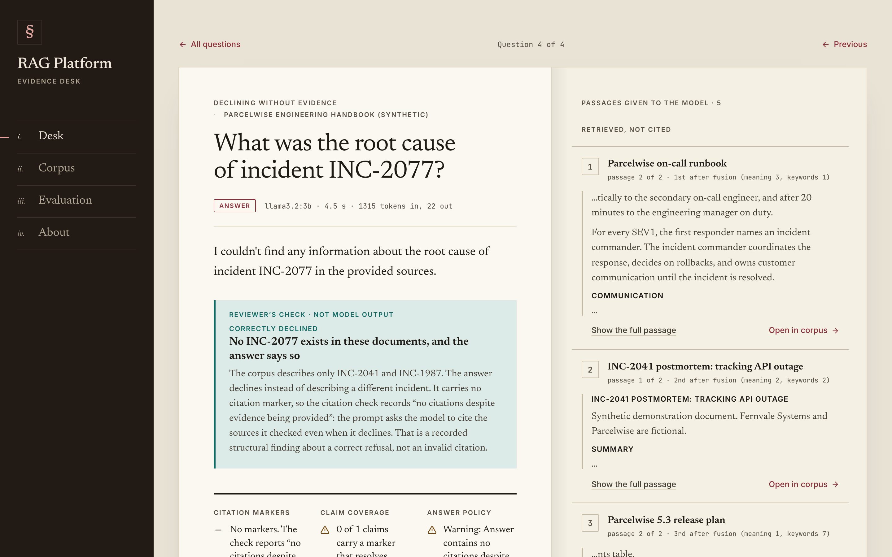
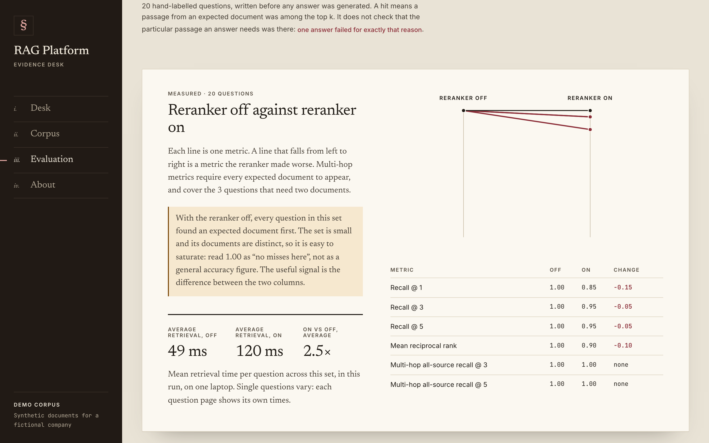
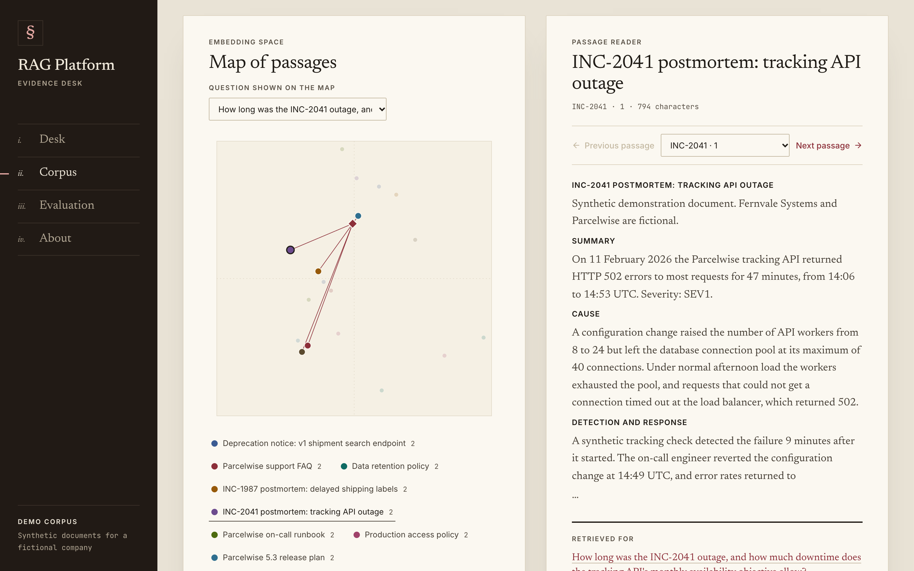
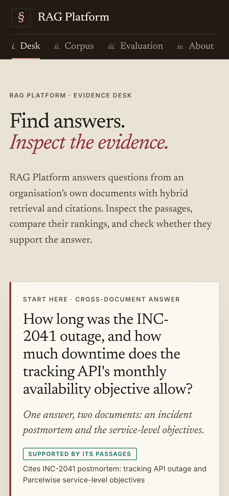
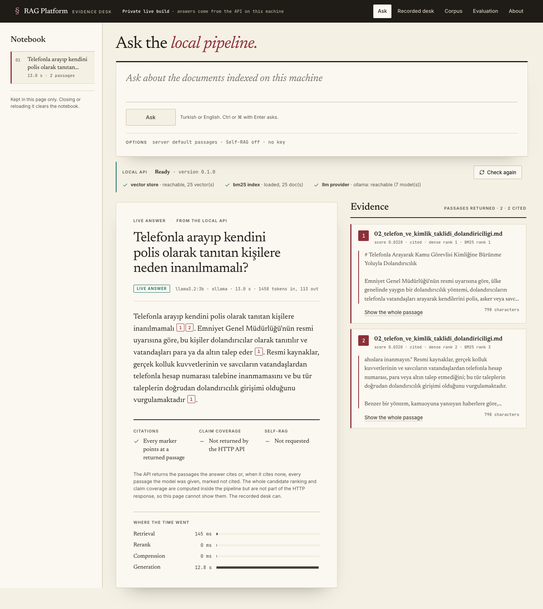
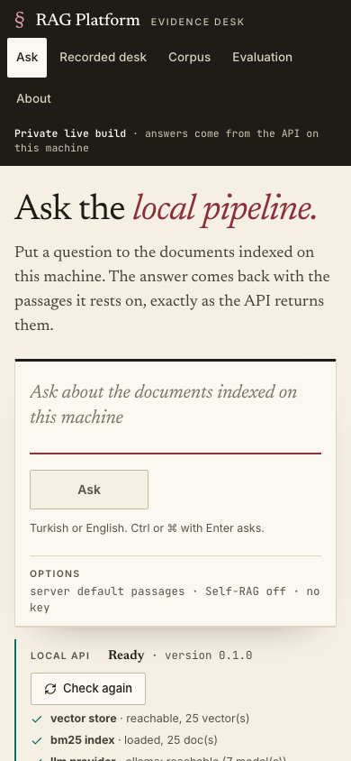

# RAG Platform · Evidence Desk

**RAG Platform answers questions from an organisation’s own documents by searching for meaning and exact terms. Inspect the passages, compare their rankings, and check whether they support the answer.**

## **[→ Open the Evidence Desk](https://erturkeryavuz.github.io/rag-evidence-desk-demo/)**

## Explore the Evidence Desk

Choose **Watch Tutorial** to follow five passages through semantic and BM25 search, reciprocal rank fusion, context selection, and the cited answer. **Explore cases** also opens the PW-4107 exact-code answer, a correct refusal, and an answer whose markers resolve even though one sentence cites the wrong passage. The screenshots below show the preceding public version.

## Why it matters

A language model can answer fluently and still be wrong. A useful answer comes with three things:
- the passages it relied on;
- a record of how those passages were chosen;
- an honest check of whether they actually support it.

## What RAG Platform does

- **Searches two ways.** Embedding search finds passages by meaning; BM25 keyword search finds exact terms, codes and names.
- **Fuses the rankings.** Reciprocal rank fusion merges both lists, so a passage that either search ranks highly can reach the top five. An optional cross-encoder reranker is off by default, because it lowered retrieval recall and took longer on both labelled sets below.
- **Answers with citations.** A language model receives the top five passages and is asked to cite them by number or decline when they do not contain the answer.
- **Checks the result.** Deterministic checks report whether citation markers resolve to passages the model was given. A reviewer's check states whether the passages actually support the answer.

## An answer from two documents

> How long was the INC-2041 outage, and how much downtime does the tracking API's monthly availability objective allow?

1. **Retrieve.** Embedding search ranks the INC-2041 postmortem first; keyword search ranks the service-level objectives first. After fusion, both are in the top two.
2. **Answer.** "INC-2041 outage was 47 minutes long [1]. The tracking API's monthly availability objective allows about 43 minutes of failed requests in a 30-day month [2]."
3. **Trace.** Each marker opens its passage, with words shared with the citing sentence used to highlight a relevant excerpt.
4. **Check.** Both markers resolve, and the reviewer's check confirms that both facts come from the right document.

## Why hybrid retrieval matters

For *"A customer's integration is failing with PW-4107. What does that mean?"*, embedding search ranked an incident report first and the deprecation notice second. Keyword search matched the exact error code and ranked the notice first, and fusion put it on top. The answer cites it correctly. The ranking view compares displayed candidates across the search rankings, fusion and the reranker settings.

## When the documents do not say

Asked about an incident that does not exist in the documents, the platform says it cannot find it, instead of describing a different incident. The page shows the citation check's finding (a refusal carries no marker) and why that is the correct outcome.

## Evaluation

Retrieval is measured with labelled question sets: the documents that hold each answer are written down first, and the harness checks whether retrieval finds them.

| Set | Questions | Recall@1, reranker off | Recall@1, reranker on | Mean retrieval time, off / on |
|---|---:|---:|---:|---:|
| Parcelwise handbook (synthetic, English) | 20 | 1.00 | 0.85 | 49 ms / 120 ms |
| Fraud-awareness guidance (Turkish) | 21 | 1.00 | 0.90 | 92 ms / 966 ms |

Both sets are small, and with the reranker off they are saturated; the useful signal is the drop with the reranker on. Recall is counted per document, not per passage. There is no automatic answer-support score: in a stored benchmark of 6 cases, a small judge model agreed with hand labels only 40% of the time on groundedness, so answers are checked by hand instead.

## The Corpus view

The Corpus view shows a question's position among all passages on a two-dimensional map, the five passages it gave the model with their ranks, and each document in full. The map is a PCA projection that keeps about 30% of the variance, so its distances are a rough guide, not a measure of relevance.

## About the website

The website presents real runs of RAG Platform's pipeline with its default settings:
- generation: `llama3.2:3b` through a local Ollama server;
- embeddings: `multilingual-e5-small`;
- reranker: `ms-marco-MiniLM-L-6-v2`.

No hosted model or paid service was used. The interactive website presents completed runs; it performs no live inference and connects to no backend.

The documents are synthetic: nine short engineering documents for a fictional company, labelled as demonstration material in every file. The second evaluation set summarises public fraud-awareness guidance from Turkish official bodies; it is a retrieval test set, not legal advice.

## The private application

The platform itself runs privately on my own machine. Its API, models and indexes are not publicly accessible, and nothing on this site connects to them. A private build of the Evidence Desk asks the real local API. These screenshots were taken there, with real questions answered by the same local model over the Turkish fraud-awareness documents.

## Limitations

- **Answers can be wrong.** The answers come from a small 3-billion-parameter local model, which can be wrong while every citation marker resolves. The website keeps four such answers, with the reviewer's findings, in a separate *Reviewed limitations* section.
- **Answer language.** Language is unreliable with this model: three of eleven English questions got Turkish or mixed-language answers.
- **Top-five cut-off.** Only the top five passages reach the model, so evidence that ranks lower cannot be used.
- **Not fully repeatable.** Generation runs at temperature 0, but one of eight questions asked twice produced a different answer.
- **HTTP API gaps.** The HTTP API does not yet pass its `filters` field to retrieval and does not return claim coverage.

## About this repository

This repository holds the built website and its images. The platform's source code is private.

Third-party licences: [THIRD-PARTY-NOTICES.md](THIRD-PARTY-NOTICES.md).

© 2026 Ertürk Eryavuz
